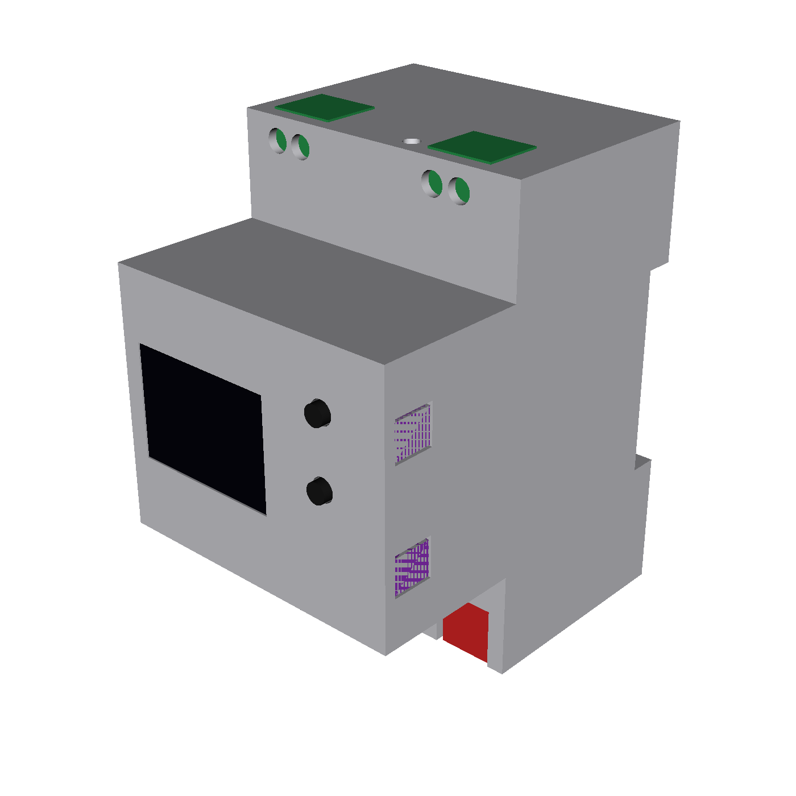

# KNX–DALI Gateway

Open-source DIN-rail gateway between a wired KNX TP line and one DALI line
(up to 64 control gear, DALI-2 input devices), configured with ETS and powered
from the KNX bus. WiFi dashboard/MQTT are optional extras; lighting never
depends on them.

**Status:** prototype. Nothing has run on real hardware yet; no KNX or DALI
certification is claimed.

## What is in the repo

| Folder | Contents |
| --- | --- |
| `gateway/` | ESP32-C6 firmware (C++17, ESP-IDF/PlatformIO), native unit tests |
| `knxprod/` | ETS product database source and generator |
| `simulation/` | DALI bus simulator and the Docker integration lab |
| `hardware/` | Circuits (SKiDL), routed KiCad boards, part libraries, `releases/` |
| `mechanical/` | Parametric 3D-printed DIN enclosure and its fit checks |
| `docker/`, `compose.yaml` | One container per tool; nothing but Docker and PlatformIO on the host |
| `.github/workflows/` | Lint, board/enclosure verification, .knxprod build, integration lab |

Hardware v1: 3 DIN modules, a 4-layer main board (KNX transceiver NCN5130,
isolated DALI interface and bus supply, Seeed XIAO ESP32-C6) and a 2-layer UI
board (0.96" OLED, two buttons, three RGB status LEDs).

## Ordering a v1 kit

Everything is in [`hardware/releases/v1/`](hardware/releases/v1/); its
[README](hardware/releases/v1/README.md) has the assembly and first power-up
steps.

1. **PCBs and SMT assembly (JLCPCB)**, per board (`main/`, `ui/`):
   - Gerbers: `<board>_gerbers.zip` (main 4 layers, ui 2 layers, both 1.6 mm).
   - Assembly: `<board>_bom_jlc.csv` + `<board>_cpl_jlc.csv`.
   - `<board>_assembly_check.csv` shows each part was checked against JLCPCB's
     own footprint; in JLC's placement preview glance at the bottom-side parts.
2. **Parts JLCPCB does not fit**: `<board>_hand_fit.csv` (KNX pin strip,
   RECOM REM3 converter, XIAO ESP32-C6, OLED module) and
   [`assembly_parts.csv`](hardware/releases/v1/assembly_parts.csv) (JST-SH
   cable, XIAO sockets, jumper caps, two 2.5 x 10 mm thread-forming screws).
3. **Enclosure**: print `enclosure/base.stl` and `enclosure/cover.stl` in
   PETG or ASA, light/translucent so the status LEDs show through the front.

## Working on it

| Task | Command |
| --- | --- |
| Firmware tests / build | `pio test -d gateway -e native`, `pio run -d gateway -e dev_c6` |
| Integration lab | `simulation/run-tests.sh` |
| ETS product (.knxprod, ETS 5.7 + 6) | `ETS_CV_DIR=knxprod/ETS knxprod/scripts/package.sh` ([how](knxprod/docs/knxprod-pipeline.md)) |
| Hardware and enclosure checks | see `.github/workflows/hardware.yml` (eda and cad containers) |
| New hardware release | `docker compose --profile hardware run --rm -T eda "python3 hardware/scripts/release.py <version>"` |
| Lint | `docker compose --profile lint run --rm lint check .`, `... cpp-lint gateway/scripts/check_cpp.sh` |
| Board / STL viewers | `docker compose --profile viewers up` (:8082 KiCanvas, :8081 STL) |

Sources are versioned; `hardware/build/` and `mechanical/build/` are local
build output. Routing (`layout.py <board> route`) is a developer step; CI
proves the committed boards are complete, DRC-clean and match the release.

Licences per folder: [`LICENSE.md`](LICENSE.md). Engineering rules and
decisions: [`AGENTS.md`](AGENTS.md).
