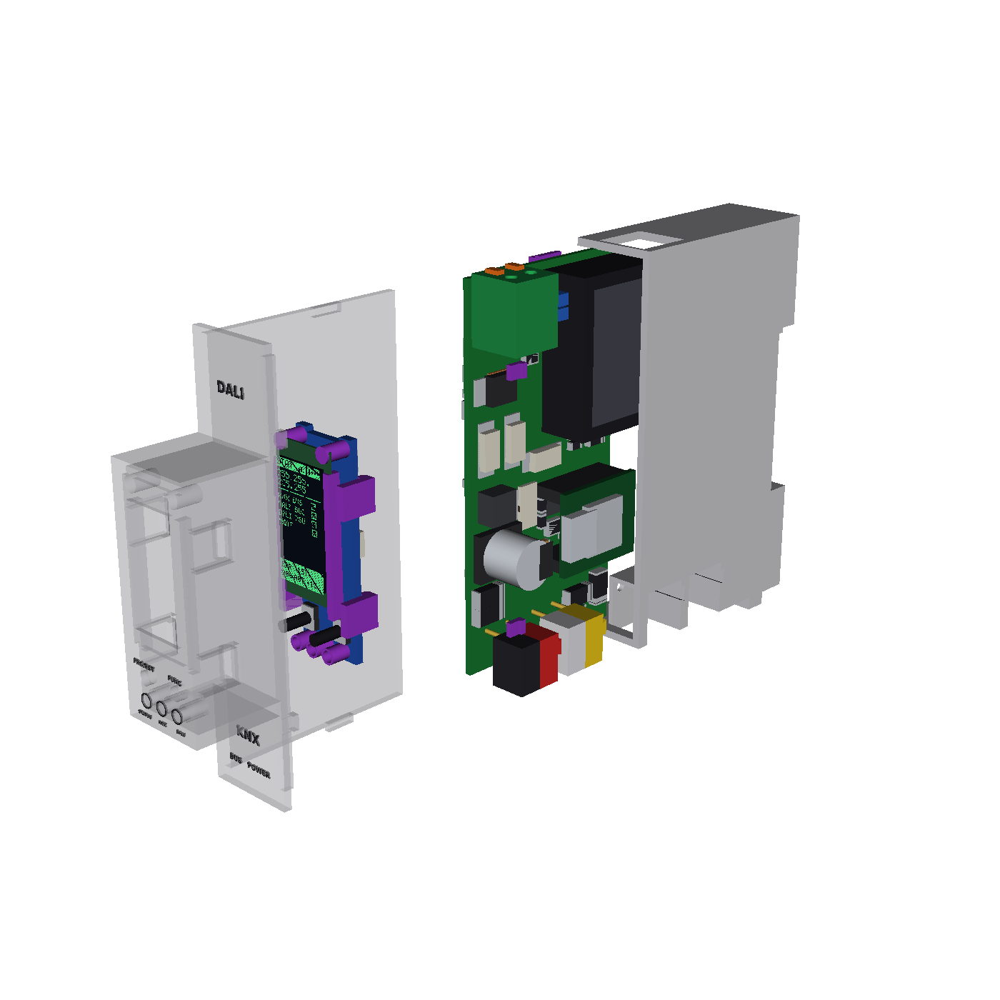
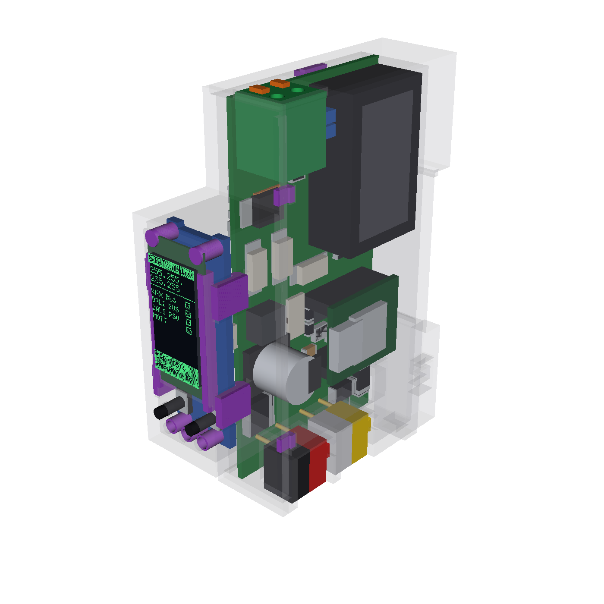
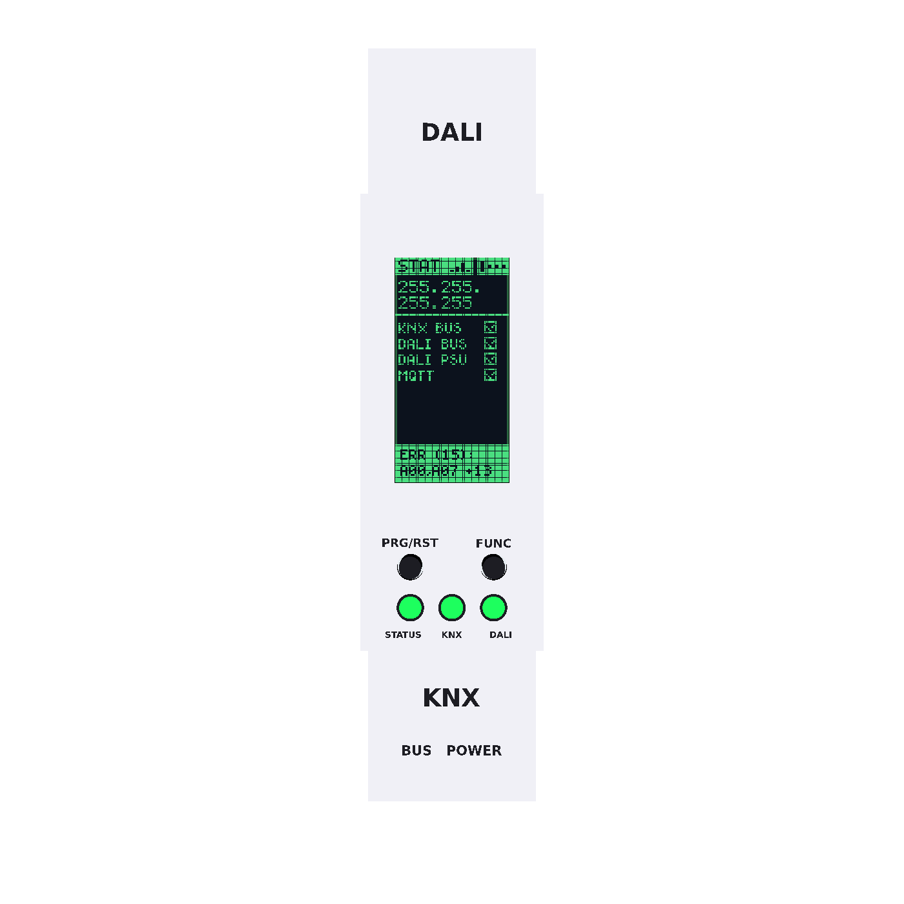
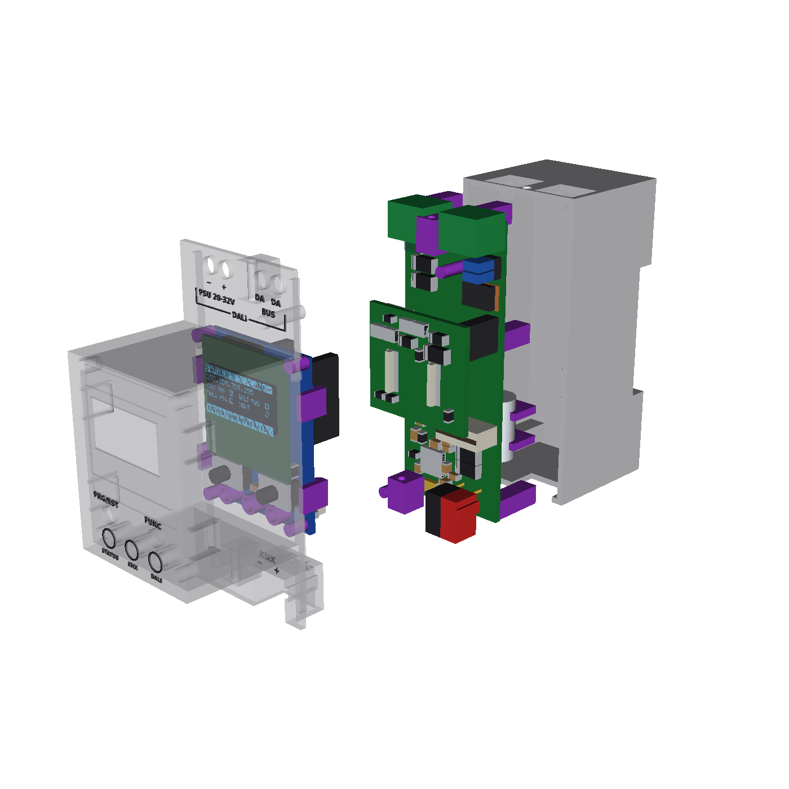
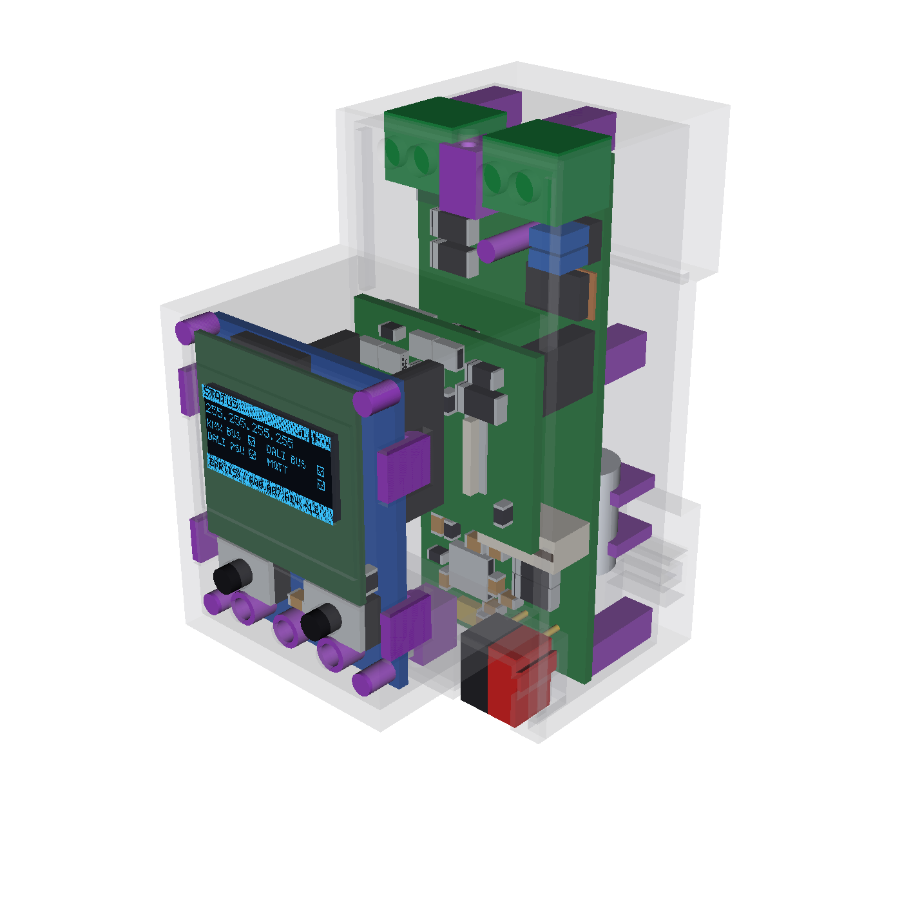

# KNX–DALI Gateway

Open-source DIN-rail gateway bridging a wired **KNX TP** line and one **DALI / DALI-2** line (up to 64 control gear + DALI-2 multi-master input devices), commissioned through **ETS** and powered from the KNX bus. An integrated isolated DALI bus supply (`RECOM REM3-2415S/A/CTRL`, fed from 20–32 V auxiliary DC or the KNX white/yellow pair) can be enabled or bypassed via jumper. WiFi dashboard and MQTT are optional extras; core lighting control and ETS provisioning never depend on them.

**Status:** pre-hardware prototype (verified in native unit tests, Docker KNX/DALI integration lab, KiCad DRC/isolation checks, JLCPCB footprint/pinout checks, and 3D CadQuery mechanical fit/probe tests; no physical board has been powered on yet, and no KNX or DALI certification is claimed).

| Variant | Side-Opening / Exploded View | Internal View | Front Face (Silk + Page 1 OLED) |
| :---: | :---: | :---: | :---: |
| **V3** *(1 DIN, 18 mm)* |  |  |  |
| **V2** *(2 DIN, 36 mm)* |  |  |  |

---

## Flashing Firmware & Downloads

| Method | Link / Files | Description |
| --- | --- | --- |
| **1. Chrome / Edge USB Web Flasher (Recommended for First Install)** | **[Open Web Flasher →](https://vbartusevicius.github.io/knx-dali-gateway/)** | Plug the XIAO ESP32-C6 into USB-C, open in Chrome/Edge, and click **Connect & Install**. Automatically flashes `bootloader.bin`, `partitions.bin`, `firmware.bin`, and `littlefs.bin` in one step via WebSerial (`manifest.json`). |
| **2. Wireless OTA Update (Web UI)** | [`firmware.bin` & `littlefs.bin`](https://github.com/vbartusevicius/knx-dali-gateway/releases/latest) | Drag and drop `firmware.bin` (application) or `littlefs.bin` (Web UI) directly onto the **Firmware** tab of the gateway's web interface. |
| **3. ETS Product Database (`.knxprod`)** | [`KnxDaliGateway.knxprod`](https://github.com/vbartusevicius/knx-dali-gateway/releases/latest) | Import into **ETS 5.7 / ETS 6** (`64` lamp channels with DT6/DT7/DT8 support, `16` DALI groups, broadcast, and `32` DALI-2 input channels = `1,321` group objects). |
| **4. Hardware Manufacturing Bundles** | [`knx-dali-gateway-hardware-v2.zip` / `v3.zip`](https://github.com/vbartusevicius/knx-dali-gateway/releases/latest) | Complete 3D-printable STLs/3MFs, STEP CAD assemblies, JLCPCB Gerbers, BOM & CPL pick-and-place files, and off-board `assembly_parts.csv`. |

---

## Web Interface & Diagnostics

The built-in web interface runs directly from the ESP32-C6 (`LittleFS` + embedded fallback, live WebSocket updates, zero cloud dependency):

### 1. Overview — 64-Lamp Bus Grid, DT8 Color Control & D4i / Calculated Power

- **Whole-Bus 8×8 Matrix (`A00–A63`):** Shows live brightness `%`, DT8 color preview bar (`2000–6500 K` CCT or `RGBW`), per-lamp wattage (native **D4i Part 252** active power when supported by the ballast, or logarithmic arc-power calculation with configurable `100% W` + `Idle W`), Lamp Finder pulsing indicator, and explicit fault codes (`ERR: E106`, `ERR: E107`).
- **Two-Tab Lamp Inspector (`Control` | `Settings`):**
  - **`Control`:** Live brightness slider, mutually exclusive DT8 color modes (`White (CCT)` | `Color (RGBW)` | `CIE xy`), and `Blink` / `Pulse` / `Stop` physical lamp finder.
  - **`Settings`:** Device type (`DT0..DT8`), dimming curve (`Logarithmic` / `Linear`), percentage dimming limits (`Min %`, `Max %`, `Power-On %`, `Bus-Fail %`), `Fade Time`, `Button Dim Speed`, and one-click `Assign New to Axx` ballast replacement.
- **DALI-2 Sensors & Buttons (`D00–D63`):** Switch the grid view to discovered `IEC 62386-103 / 301–304` push-button couplers, occupancy sensors, and light sensors with per-instance event filters and physical LED identification (`Identify LED`).

### 2. Groups & Scenes — Scene Toolbar, 4×4 Group Matrix & Lamp Assignment

- **Scenes (`1–16`):** Recall or save current lamp levels into any DALI scene.
- **DALI Groups (`G00–G15`):** Select any group on the left to adjust its group brightness, DT8 group color (`White CCT`, `RGBW`, `CIE xy`), or click installed lamps to add/remove group memberships directly in the ballast's EEPROM.

### 3. Errors & Live DALI Bus Frame Monitor (`1,024`-Row Hardware Ring Buffer + `10,000`-Row Browser Session)
| Persistent NVS Error History & Remedies | Live DALI Bus Frame Monitor (16-bit & 24-bit) |
| :---: | :---: |
|  |  |

- **Background Hardware Capture:** Captures 16-bit lamp commands, 8-bit replies, 24-bit DALI-2 sensor events, and bus collisions into a `1,024`-row ring buffer on the ESP32-C6 (filtering out routine `OK` health polls so overnight recording preserves real events even with the browser closed) while accumulating up to `10,000` rows in the browser session.

### 4. Settings & Home Assistant Auto-Discovery

- **Home Assistant MQTT Auto-Discovery:** Publishes one central Gateway device (with total power `W`, energy `Wh`, firmware version, and `Visit` link) and links only populated DALI lamps (`via_device`) with on/off, dimming, DT8 color, per-lamp power sensor, and fault sensor.

---

## Front-Panel OLED Display (V2 Landscape vs. V3 Portrait)

The front-panel OLED automatically adapts between **V1/V2 (`128×64` Landscape SSD1306)** and **V3 (`64×128` Portrait SSD1312)**, providing cabinet-level diagnostics and a 5-second `FUNC` hold shortcut to launch the WiFi setup portal:

---

## How It Works

1. **KNX TP Side (`SELV-KNX` domain):**
   - An **onsemi `NCN5130`** bus transceiver handles KNX TP Layer-2 framing at 19200 baud (9-bit UART) and charges a **470 µF / 35 V storage capacitor** (`VFILT`).
   - An **`SCT2400`** buck converter steps `VFILT` down to `+5V` (with UVLO above the `NCN5130`'s `SAVEB` threshold), feeding the **Seeed XIAO ESP32-C6** through a **`TI LM66100`** ideal diode so USB-C service power cannot back-feed the KNX side.
2. **DALI Side (`DALI` & `SELV-AUX` domains, reinforced 6 mm isolation):**
   - **Auxiliary input (`J2`, 20–32 V DC):** protected by a `1.1 A` 1812 PTC fuse, `SMAJ33A` TVS and reverse-blocking Schottky diode, feeding a **RECOM `REM3-2415S/A/CTRL`** (`5 kVAC` reinforced-isolated `24 V → 15 V, 200 mA` DC-DC converter).
   - **Firmware supply shut-off (`DALI_SUPPLY_OFF`):** XIAO `D1/GPIO1` drives a **`TLP383`** optocoupler (`U4`) that pulls `REM3` pin 1 (`CTRL`) to ~`5.6 V` to switch the internal DALI supply off on a sustained bus short; a `2×2` jumper (`JP1`) also disconnects both DALI poles when an external DALI PSU is used.
   - **Current limiter & transceiver:** an **`MJD45H11` + `BC857`** linear current limiter caps bus supply current at ~`180 mA`; DALI TX (`IRLML0060` MOSFET sink with bootstrap gate drive) and DALI RX (two-NPN constant-current threshold detector with `5.6 V` zener) cross the `6 mm` milled isolation barrier through two long-creepage **`TLP383`** optocouplers.
3. **Front Panel (`ui` board):**
   - **OLED display** (`I2C`, `0x3C`), **two tactile buttons** (`SW1 PRG/RST`, `SW2 FUNC`) on a single ADC resistor ladder (`D2/GPIO2`), and **three addressable `SK6805-EC15` RGB LEDs** (`D1 STATUS`, `D2 KNX`, `D3 DALI`) driven from `D0/GPIO0` through a 5 V `SN74AHCT1G125` level-shifter.

---

## Hardware Variants

All three variants share the same circuit blocks (`hardware/circuits/blocks/`), the same `REM3-2415S/A/CTRL` converter, and the exact same XIAO ESP32-C6 pinout (`gateway/src/firmware/Board.hpp`):

| Variant | Width | Boards | Interconnect | DALI Terminal | KNX & AUX Terminals | Display | Case Retention | Release Folder |
| --- | --- | --- | --- | --- | --- | --- | --- | --- |
| **V1** (`v1`) | **3 DIN** (`54 mm`) | **2** (`main`, `ui`) | 10-pin JST-SH cable | `MX126-5.0-02P` screw | `PST 1,0` KNX + `MX126` AUX screw | Winstar `WEA012864D-03` 0.96" 128×64 (4-pin THT) | 2 × `2.5×10` screws + UI snaps | [`hardware/releases/v1/`](hardware/releases/v1/README.md) |
| **V2** (`v2`) | **2 DIN** (`36 mm`) | **3** (`main`, `interface`, `ui`) | 10-pin JST-SH cable + `1×4` & `1×3` B2B headers | `MX126-5.0-02P` screw | `PST 1,0` KNX + `MX126` AUX screw | Winstar `WEA012864D-03` 0.96" 128×64 (4-pin THT) | 2 × `2.5×10` screws + UI snaps | [`hardware/releases/v2/`](hardware/releases/v2/README.md) |
| **V3** (`v3`) | **1 DIN** (`18 mm`) | **2** (`main` two-sided vertical, `ui`) | 8-pin `0.5 mm` FFC (`50 mm`, `C6936295`) | Kefa `KF142R-5.08-2P` push-in spring (`C475144`) | Two `PST 1,0` pin strips on `main` (red/black KNX + yellow/white AUX, right-side pockets) | 0.96" `64×128` portrait `SSD1312` (`QG-6428TSWCG02`, `14 × 28 mm`, 14-pin `0.5 mm` ZIF `C2856800`, no soldering) | Side-opening clamshell with 4 side snap-clicks + UI snaps | [`hardware/releases/v3/`](hardware/releases/v3/README.md) |

Detailed electrical and mechanical notes, including the XIAO `D0..D10` pin table, LED chain indexing, and ADC button ladder voltages: [`hardware/docs/variants.md`](hardware/docs/variants.md).

---

## Using the Files in `hardware/releases/<variant>/`

Each release folder (`hardware/releases/v1/`, `v2/`, `v3/`) is a complete, DRC-clean, pinout-verified manufacturing package:

### 1. Order PCBs & SMT Assembly at JLCPCB
For each board subfolder in the release (`main/`, `ui/`, and `interface/` on V2):
1. **Upload Gerbers:** `<board>_gerbers.zip`
   - **V1:** `main` 4 layers (`1.6 mm`), `ui` 2 layers (`1.6 mm`).
   - **V2:** `main`, `interface`, `ui` 4 layers (`1.6 mm`).
   - **V3:** `main` 4 layers (**`1.2 mm`**), `ui` 4 layers (`1.6 mm`).
2. **Enable PCB Assembly (Both Sides):** upload `<board>_bom_jlc.csv` (BOM) and `<board>_cpl_jlc.csv` (Pick & Place / CPL).
3. **Verify Placement Preview:** `<board>_assembly_check.csv` records the verified JLCPCB footprint, rotation and centre offset for every part. Check `<board>/renders/top.svg` and `bottom.svg` against JLCPCB's 3D preview.

### 2. Order Hand-Fitted & Off-Board Parts
- **`assembly_parts.csv`** (at the root of `hardware/releases/<variant>/`, generated automatically from the circuit netlists and `spec.yaml`) lists every part not placed by JLCPCB:
  - **Seeed XIAO ESP32-C6 Pre-Soldered (`102010636`)** + two `1×7` `2.54 mm` female socket strips (`5.0 mm` tall on V3, `8.5 mm` tall on V1/V2).
  - **RECOM `REM3-2415S/A/CTRL`** isolated DC-DC converter (`main U3`).
  - **Phoenix Contact `PST 1,0/2-5,75 R32` (`1574200`)** pin strips + mating **red/black KNX plug (`1574300`)** and (on V3) **yellow/white AUX plug (`1574299`)**.
  - **OLED display:** Winstar `WEA012864DWPP3N00003` (0.96" `128×64` 4-pin THT on V1/V2) or **`QG-6428TSWCG02` / `JLX12864OLED-S096W`** (0.96" `64×128` portrait `SSD1312`, `14.0 × 28.0 mm`, 14-pin `0.5 mm` ZIF plug-in flex tail on V3, adhered with `1.0 mm` double-sided foam tape onto the cover's backing rails — zero hand-soldering on the V3 UI board).
  - **Board-to-board cable** (`50 mm` 8-pin `0.5 mm` FFC `C6936295` on V3; `100 mm` 10-pin JST-SH cable on V1/V2) and two `2.54 mm` jumper caps (`C100114`) for `JP1`.

### 3. 3D-Print the DIN-Rail Enclosure (`enclosure/`)
Each release's `enclosure/` directory contains:
- **`base.stl` / `base.step`:** DIN-rail base with integrated TS35 rail hook and S-meander sliding latch (print rail-face down in PETG or ASA, `0.2 mm` layers).
- **Three cover options** (all generated from the same `front_legend.svg` artwork):
  1. **`cover.stl` / `cover.step`:** standard single-colour cover.
  2. **`cover_embossed.stl` / `cover_embossed.step`:** single-colour cover with **`0.3 mm` recessed (debossed) text and LED rings** cut into the cover faces (ideal for single-colour printing).
  3. **`cover_color.3mf` / `cover_color_obj.zip`:** multi-material / full-colour WJP resin cover (`0.3 mm` flush inlaid text bodies).
- **Assembly (`V3` 1-DIN):**
  1. Snap the `ui` board into the cover's front protrusion, fold the 0.96" `64×128` OLED's flex tail through the `1.0 mm` top cutout on the UI board into the 14-pin ZIF connector `J2`, and stick the OLED onto the cover's backing rails with `1.0 mm` double-sided foam tape.
  2. Slide the `main` board into `base` **from the open left side (`-x → +x`)** so `J1` and `J2`'s pins pass straight through the four `Ø 2.2 mm` holes into the right-side KNX/AUX pockets and `J3` (`KF142R`) seats in the top opening.
  3. Connect the `50 mm` 8-pin FFC cable between `main J4` and `ui J1`, then close `cover` over the left side and front until the **four side snap-click hooks** lock into `base`.

---

## Repository Structure & Developer Commands

| Folder | Contents |
| --- | --- |
| `gateway/` | ESP32-C6 firmware (`C++17`, ESP-IDF 5.5 / PlatformIO) and 274 native unit tests |
| `knxprod/` | ETS product database source and `.knxprod` builder (OpenKNXproducer in Docker) |
| `simulation/` | DALI bus simulator and 22-scenario Docker KNX/DALI integration lab |
| `hardware/` | SKiDL circuit generators (`circuits/`), KiCad PCB layouts (`layout/`), supplier/pinout data (`product/`), unified build script (`scripts/build.py`), and fabrication packages (`releases/`) |
| `mechanical/` | Parametric CadQuery DIN enclosures, fit drawings, front legends, 3MF/embossed models, and VTK 3D renders |

| Task | Command |
| --- | --- |
| **Build, route, render, release & test all hardware variants (`v1`, `v2`, `v3`) in parallel** | `python3 hardware/scripts/build.py` |
| **Build/test a single variant (e.g. `v3`)** | `python3 hardware/scripts/build.py v3` (`--eda`, `--cad`, `--release`, `--test`) |
| **Firmware unit tests & ESP32-C6 build** | `pio test -d gateway -e native && pio run -d gateway -e dev_c6 -e release_c6` |
| **Refresh clangd compilation database** | `pio run -d gateway -e dev_c6 -t compiledb` |
| **Docker KNX/DALI integration lab** | `simulation/run-tests.sh` |
| **Build ETS `.knxprod` package** | `ETS_CV_DIR=knxprod/ETS knxprod/scripts/package.sh` |
| **Lint (Python, YAML, C++)** | `docker compose --profile lint run --rm lint check .` |

Licences per folder: [`LICENSE.md`](LICENSE.md). Engineering rules and architecture notes: [`AGENTS.md`](AGENTS.md).
