# KNX–DALI Gateway

Open-source DIN-rail gateway between a wired **KNX TP** line and one **DALI / DALI-2** line: up to 64 control gear plus DALI-2 multi-master input devices, commissioned entirely through **ETS**. An optional integrated, isolated DALI bus supply runs from 20–32 V auxiliary DC (a 24 V PSU or the KNX white/yellow pair); the same input also powers the gateway core, with the KNX bus as a seamless fallback. The WiFi dashboard and MQTT are extras: lighting control and ETS provisioning never depend on them.

> [!NOTE]
> **Pre-hardware prototype.** Verified by native unit tests, a Docker KNX/DALI integration lab, KiCad DRC and isolation checks, JLCPCB footprint and pinout checks, and exact-solid CadQuery fit tests. No board has been powered on yet, and no KNX or DALI certification is claimed.

  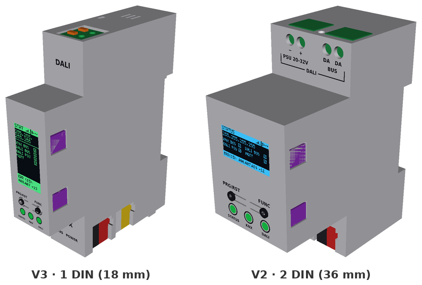

  <a href="#downloads">Downloads</a> ·
  <a href="#screenshots">Screenshots</a> ·
  <a href="#hardware">Hardware</a> ·
  <a href="#building-one">Building one</a> ·
  <a href="#how-it-works">How it works</a> ·
  <a href="#development">Development</a>

---

## Downloads

| What | Where | Use |
| --- | --- | --- |
| **USB web flasher** (first install) | **[Open Web Flasher →](https://vbartusevicius.github.io/knx-dali-gateway/)** | Plug the XIAO ESP32-C6 into USB-C, open the page in Chrome/Edge, click **Connect & Install**. Flashes bootloader, partitions, firmware and web UI in one step. |
| **OTA update** | [`firmware.bin`, `littlefs.bin`](https://github.com/vbartusevicius/knx-dali-gateway/releases/latest) | Drop either file onto the **Firmware** tab of the web interface. |
| **ETS product database** | [`KnxDaliGateway.knxprod`](https://github.com/vbartusevicius/knx-dali-gateway/releases/latest) | Import into ETS 5.7 / 6: 64 lamp channels (DT6/DT7/DT8), 16 groups, broadcast, 32 DALI-2 input channels (1,321 group objects). |
| **Hardware bundles** | [`knx-dali-gateway-hardware-v2.zip` / `v3.zip`](https://github.com/vbartusevicius/knx-dali-gateway/releases/latest) | Gerbers, JLCPCB BOM/CPL, STEP assemblies, printable STL/3MF case, `assembly_parts.csv`. |

---

## Screenshots

The web interface is served by the ESP32-C6 itself (LittleFS, live WebSocket updates, no cloud):

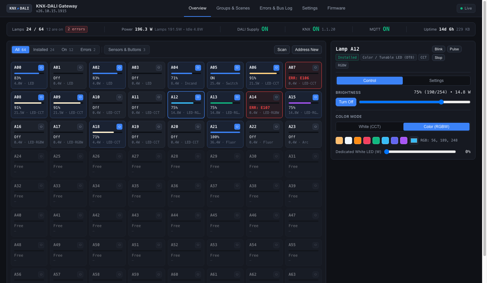

<b>More of the web interface</b>: lamp settings, groups and scenes, error log, bus monitor, settings

 

| Lamp settings | Groups & scenes |
| :---: | :---: |
| 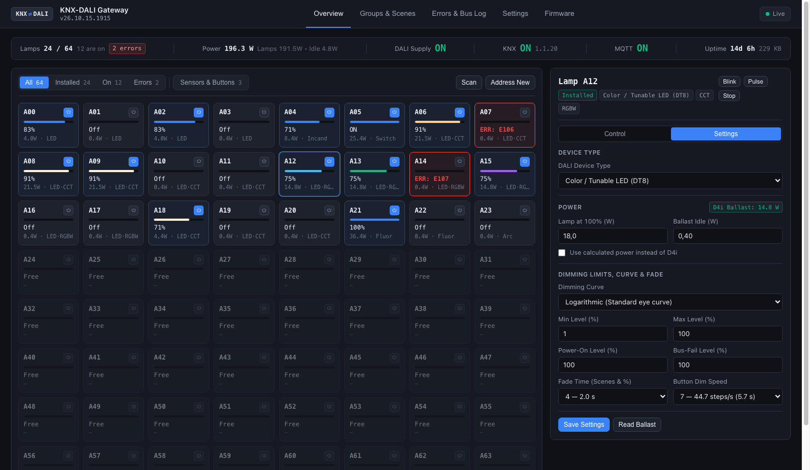 | 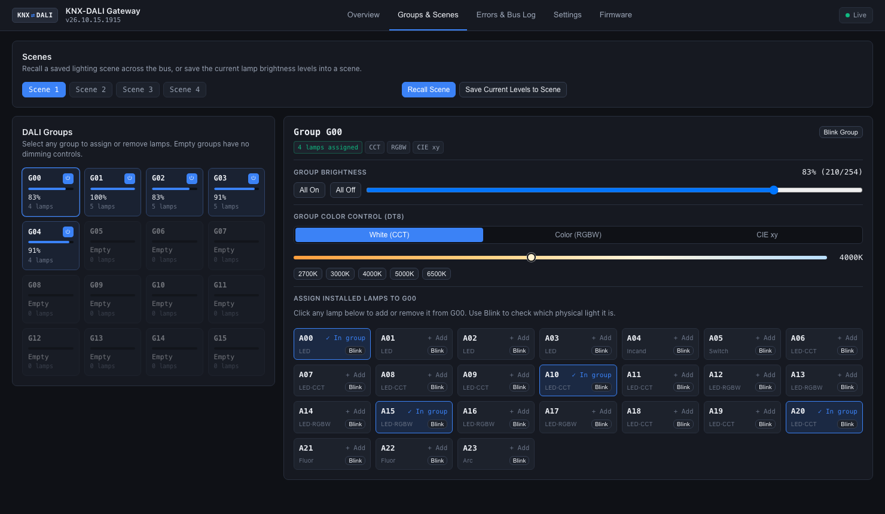 |
| Device type, dimming curve, limits, fade, D4i or calculated power, ballast replacement | 16 scenes, 16 groups (G00–G15), group colour, membership written to the ballast |
| **Error log** | **Live DALI bus monitor** |
| 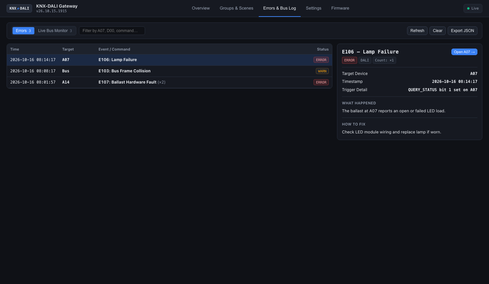 | 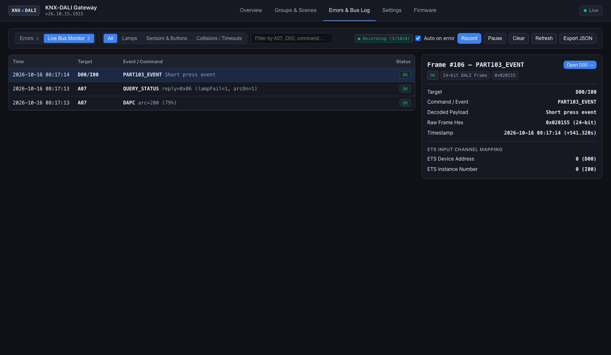 |
| Persistent NVS history with remedies | 8/16/24-bit frames and collisions: 1,024 rows on the device, 10,000 in the browser |
| **Settings** | |
| 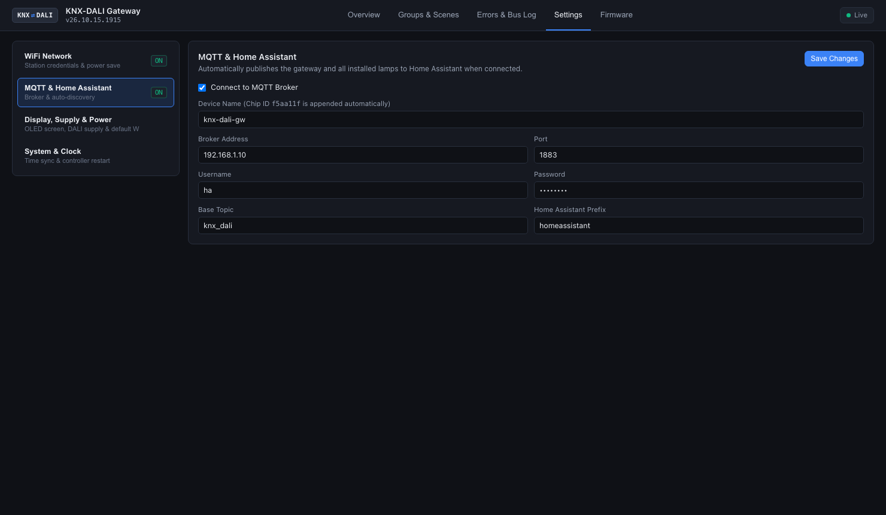 | |
| WiFi, MQTT with Home Assistant auto-discovery, power model | |

- **Overview:** live level, DT8 colour (Tc, RGBW, xy), per-lamp power (native D4i Part 252 or calculated), lamp finder, fault codes; a second grid for DALI-2 buttons and sensors (IEC 62386-103 / 301–304).
- **Home Assistant:** one gateway device (total power and energy) plus every populated lamp with on/off, dimming, colour, power and fault entities.

<b>Front-panel OLED pages</b>: V3 portrait 64×128, V2 landscape 128×64

 

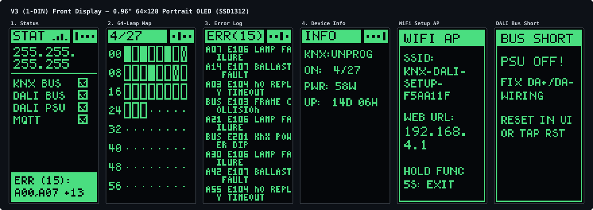

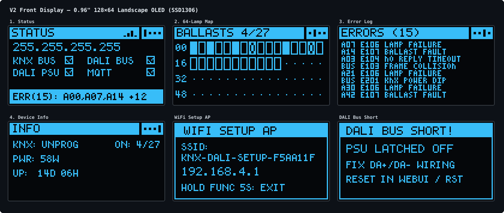

`FUNC` steps through the pages; holding it for 5 s starts the WiFi setup portal.

---

## Hardware

Two variants share the circuit blocks (`hardware/circuits/blocks/`), the XIAO ESP32-C6 pinout (`gateway/src/firmware/Board.hpp`) and the firmware:

| | **V3** (`v3`) | **V2** (`v2`) |
| --- | --- | --- |
| Width | 1 DIN (18 mm) | 2 DIN (36 mm) |
| Boards | 2: two-sided vertical `main`, front `ui` | 3: `main`, `interface`, `ui` |
| AUX core converter | TRACO TMR 2411 (2 W), on a tongue of `main` in the front protrusion | TRACO TRN 3-2411 (3 W), on the back of `main` |
| DALI terminal | Kefa KF142R push-in | MX126 screw |
| KNX / AUX | PST 1,0 pin strips (red/black, yellow/white plugs) | PST 1,0 KNX, MX126 screw AUX |
| Display | 0.96" 64×128 portrait SSD1312, solder flex tail | 0.96" 128×64 SSD1306 module, 4-pin header |
| Buttons | Omron B3U pressed through C-shaped spring tabs in the cover | same |
| Main ↔ UI link | 8-pin 0.5 mm FFC (Type B, 50 mm) | 10-pin JST-SH cable |
| Case | Side-opening clamshell, snap-fit | Two 2.5×10 screws, UI snaps |
| Release | [`hardware/releases/v3/`](hardware/releases/v3/README.md) | [`hardware/releases/v2/`](hardware/releases/v2/README.md) |

<b>V3 renders</b>: assembly and boards

 

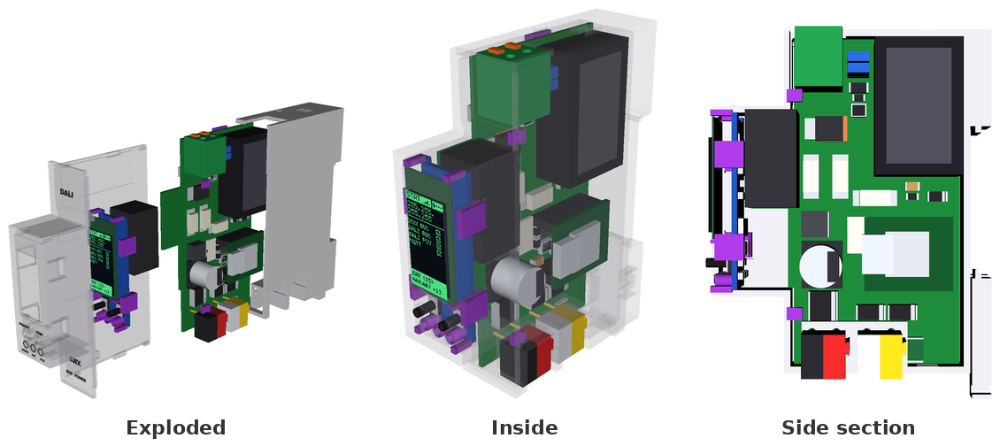

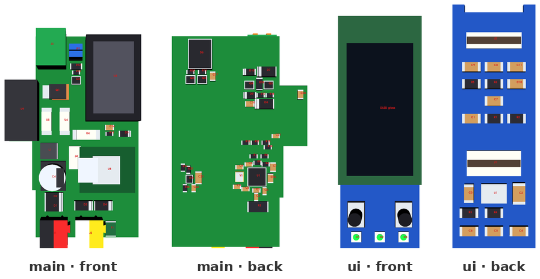

PCB artwork: [`main` top](hardware/releases/v3/main/renders/top.svg) · [bottom](hardware/releases/v3/main/renders/bottom.svg) · [`ui` top](hardware/releases/v3/ui/renders/top.svg) · [bottom](hardware/releases/v3/ui/renders/bottom.svg).
Fit drawings: [front](hardware/releases/v3/enclosure/fit_front.svg) · [side](hardware/releases/v3/enclosure/fit_side.svg).

<b>V2 renders</b>: assembly and boards

 

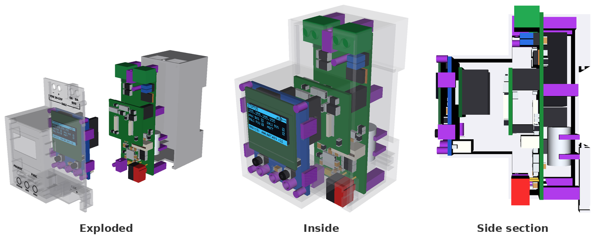

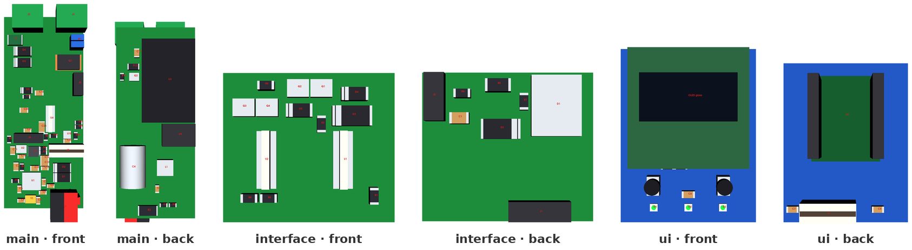

PCB artwork: [`main` top](hardware/releases/v2/main/renders/top.svg) · [bottom](hardware/releases/v2/main/renders/bottom.svg) · [`interface` top](hardware/releases/v2/interface/renders/top.svg) · [bottom](hardware/releases/v2/interface/renders/bottom.svg) · [`ui` top](hardware/releases/v2/ui/renders/top.svg) · [bottom](hardware/releases/v2/ui/renders/bottom.svg).
Fit drawings: [front](hardware/releases/v2/enclosure/fit_front.svg) · [side](hardware/releases/v2/enclosure/fit_side.svg).

Pin table, LED chain and button ladder: [`hardware/docs/variants.md`](hardware/docs/variants.md). Pre-manufacturing reviews: [`review-2026-10-23.md`](hardware/docs/review-2026-10-23.md), [`review-2026-10-22.md`](hardware/docs/review-2026-10-22.md); rework for boards made from `59eea1f`: [`rework-rev-c.md`](hardware/docs/rework-rev-c.md).

---

## Building one

Each `hardware/releases/<variant>/` folder is a complete manufacturing package.

1. **PCBs with SMT assembly (JLCPCB).** Upload `panel/panel_gerbers.zip` (V3: 66.0 × 78.1 mm, 4 layers, 1.2 mm; V2: 98.5 × 76.6 mm, 4 layers, 1.6 mm) with **assembly on both sides**, `panel/panel_bom_jlc.csv` and `panel/panel_cpl_jlc.csv`. You order one PCB and one PCBA job and snap the boards apart. Per-board files are in `main/`, `ui/` (and `interface/` on V2). Compare `renders/top.svg` / `bottom.svg` with JLCPCB's placement preview.
2. **Hand-fitted parts.** `assembly_parts.csv` lists everything JLCPCB does not place, with Mouser, Digi-Key and TME numbers:
   - the XIAO ESP32-C6 (pre-soldered) and its sockets;
   - the RECOM REC3-2415SRW/H2/A/CTRL DALI supply converter;
   - the TRACO AUX core converter;
   - Phoenix PST pin strips and plugs;
   - the OLED, the main-to-UI cable, and two jumper caps for `JP1`.
3. **Case.** Print `enclosure/base.stl` and one cover in PETG or ASA at 0.2 mm layers: `cover.stl` (plain), `cover_embossed.stl` (0.3 mm recessed legend) or `cover_color.3mf` (multi-colour inlay).

<b>V3 assembly order</b>

1. Lay the OLED face down in the cover recess, fold its flex tail through the UI board's top notch and solder it to `J2`, put the 4 mm foam pad on the UI board, snap the UI board in.
2. Slide `main` into the base from the open left side, so the KNX/AUX pins pass into the right-side pockets and `J3` seats in the top opening.
3. Plug the FFC into `main J4` and `ui J1`, then close the cover over the left side and front until the four side snaps lock.

---

## How it works

- **KNX side:** an onsemi NCN5130 transceiver (TP1, 9-bit UART) charges a 470 µF store. An SCT2400 buck makes 5 V from it, with an undervoltage lockout above the NCN5130 reset level.
- **Core supply:** the AUX input feeds an isolated TRACO converter (SELV-AUX to SELV-KNX). A TI TPS2121 priority mux prefers it and falls back to the KNX buck. A TI LM66100 keeps USB service power out of the core rail.
- **DALI supply:** the AUX input (PTC, TVS, reverse diode) feeds a RECOM REC3-2415SRW/H2/A/CTRL (24 V → 15 V, functional isolation), then a linear current limiter. The firmware can switch it off through an optocoupler on its `CTRL` pin, and jumper `JP1` disconnects it for an external DALI PSU.
- **DALI transceiver:** TX uses a MOSFET sink with bootstrap gate drive and a 275–350 mA fault clamp. RX uses a zener threshold with a constant-current detector. Both cross a 6 mm milled barrier through TLP383 optocouplers.
- **Front panel:** the OLED (I2C), two buttons on one ADC ladder, and three SK6805 RGB LEDs (status, KNX, DALI) behind a 5 V level shifter.

---

## Development

| Folder | Contents |
| --- | --- |
| `gateway/` | ESP32-C6 firmware (C++17, ESP-IDF / PlatformIO) and native unit tests |
| `knxprod/` | ETS product database source and `.knxprod` builder |
| `simulation/` | DALI bus simulator and Docker KNX/DALI integration lab |
| `hardware/` | SKiDL circuits, KiCad layouts, part data, build scripts, release packages |
| `mechanical/` | CadQuery enclosures, fit drawings, front legends, 3D renders |

| Task | Command |
| --- | --- |
| Build, route, render, release and test both hardware variants | `python3 hardware/scripts/build.py` |
| One variant or step | `python3 hardware/scripts/build.py v3 --eda` (`--cad`, `--release`, `--test`) |
| Refresh the README images (after a release) | `docker compose --profile hardware run --rm -T cad "python3 mechanical/scripts/readme_images.py"` |
| Firmware tests and ESP32-C6 build | `pio test -d gateway -e native && pio run -d gateway -e dev_c6 -e release_c6` |
| Refresh the clangd compilation database | `pio run -d gateway -e dev_c6 -t compiledb` |
| Integration lab | `simulation/run-tests.sh` |
| ETS package | `ETS_CV_DIR=knxprod/ETS knxprod/scripts/package.sh` |
| Lint (Python, YAML, C++) | `docker compose --profile lint run --rm lint check .` |

Licences per folder: [`LICENSE.md`](LICENSE.md). Engineering rules and architecture notes: [`AGENTS.md`](AGENTS.md).
