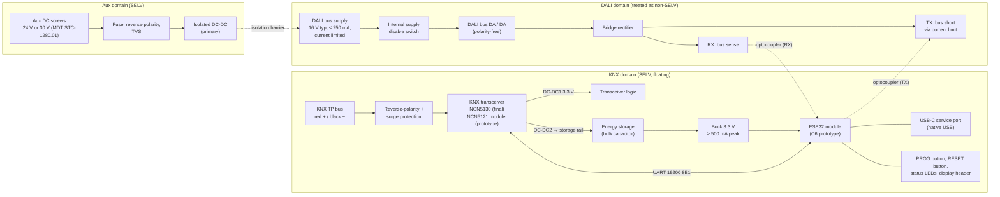
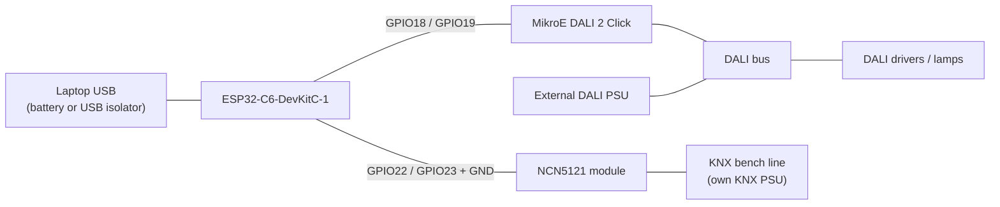

# Hardware architecture (draft, not validated)

Status: concept drawings for discussion. Nothing here is a validated or certified design. Every circuit block still needs datasheet-level design, bench measurement, and an insulation/safety review before a PCB is ordered.

## 1. System blocks

Design intent:

- The ESP32 and all gateway-core electronics run from KNX red/black only. The auxiliary input powers only the optional internal DALI supply.
- Three galvanically separated domains: KNX (SELV, floating), auxiliary (SELV) and DALI. Treat DALI as not SELV, because DALI wiring may share cables and enclosures with mains. The required insulation class (basic or reinforced) and creepage/clearance distances still have to be determined against IEC 62386-101 and the installation context.
- The KNX bus must stay floating. The aux supply's minus must never connect to KNX minus, which is why the DALI supply uses an isolated converter even though both inputs are SELV.
- A switch disables the internal DALI supply when an external DALI supply is used. Firmware does not depend on it.

## 2. Power from the KNX bus

### Budget (worst case at minimum bus voltage)

| Item | Value | Source / note |
| --- | --- | --- |
| Bus voltage at device | 21 V minimum | KNX TP operating range used for worst case |
| Max bus current, NCN5121 | 24 mA (20 mA fan-in class) | onsemi NCN5121/NCN5130 eval board manual |
| Max bus current, NCN5130 | up to 40 mA (external fan-in resistor) | same source; selects NCN5130 for the final PCB |
| Input power at 21 V × 40 mA | 0.84 W | calculation |
| Assumed conversion efficiency | ~85 % overall | NCN DC-DC ~90 % at 25 V/35 mA (datasheet) times a second buck; to be measured |
| Average power available at 3.3 V | ~0.71 W ≈ 216 mA | calculation, before transceiver self-consumption |
| NCN DC-DC1 output limit | 100 mA | eval board manual; too small for an ESP32 with Wi-Fi |
| ESP32-C6 Wi-Fi TX peak | 252–354 mA | ESP32-C6 datasheet v1.5, table 5-7 |
| ESP32-C6 Wi-Fi RX | 78–82 mA | table 5-7 |
| ESP32-C6 modem-sleep, CPU 160 MHz running | 27–38 mA | table 5-10 |
| ESP32-C6 light-sleep | 0.18 mA | table 5-11 |

Conclusions to verify on the bench:

- Average consumption fits only if Wi-Fi stays in power-save (modem sleep between beacons). Continuous RX plus a running CPU (~110–120 mA) is within the ~216 mA ceiling; continuous TX is not.
- TX bursts exceed the average budget and must come from stored energy. One 10 ms burst at 354 mA × 3.3 V is ~12 mJ. A 1000 µF capacitor discharging from 12 V to 6 V holds ~54 mJ.
- DC-DC2 charging current must keep total bus current inside the fan-in limit. Otherwise the transceiver's supply droops and it resets. This interaction is the main open design question; it needs the NCN5130 application note and measurements.
- Firmware must cap Wi-Fi TX power and throughput (dashboard, OTA) and keep brownout detection enabled.

## 3. Prototype bench wiring (C6 DevKit + off-the-shelf boards)

Matches gateway/src/firmware/Board.hpp.

| ESP32-C6-DevKitC-1 | Connects to | Notes |
| --- | --- | --- |
| GPIO18 | DALI 2 Click TX (mikroBUS RST pin) | Click inverts; firmware sets invert_tx |
| GPIO19 | DALI 2 Click RX (mikroBUS INT pin) | Click inverts; firmware sets invert_rx |
| 3V3, GND | DALI 2 Click 3.3 V, GND | Click jumper on 3.3 V |
| GPIO22 (UART1 TX) | NCN5121 module RXD | 3.3 V logic only |
| GPIO23 (UART1 RX) | NCN5121 module TXD | 3.3 V logic only |
| GND | NCN5121 module GND | ties KNX minus to DevKit ground |
| GPIO9 (BOOT button) | KNX programming button | active low |
| GPIO8 (onboard RGB LED) | KNX programming LED | WS2812 |
| USB-C (USB port) | Laptop | power, flashing, console |

Bench safety notes:

- Power the DevKit from USB, not from the NCN5121 module's 3.3 V output (100 mA limit).
- The shared GND earth-references the KNX line through the laptop when it runs on mains. Use a separate bench KNX line, a battery-powered laptop, or a USB isolator. Do not connect this setup to the live house installation.
- The DALI 2 Click needs an external DALI bus supply.

## 4. Open items

- Choose the final ESP32 module (C6 or S3) after measuring the power budget.
- NCN5130 DC-DC2/storage topology and fan-in interaction (section 2).
- DALI interface circuit: TX current capability ≥ 250 mA, timing, optocoupler choice and insulation rating.
- Isolated DALI supply: converter, 16 V regulation, 250 mA current limit, input range 24–30 V with protection.
- Insulation class, creepage/clearance and DIN-enclosure layout (2-module envelope).
- USB live-debugging method (recommendation: external USB isolator, not onboard isolation).
- Schematic capture tool for the KiCad sources (see section 5).

## 5. Next drawing step

The next step is a KiCad schematic of the prototype-level design (transceiver, power path, MCU, DALI interface). Everything stays editable, versioned source under hardware/kicad. Rendered PDF/SVG outputs are produced by KiCad's command-line tool in Docker, not committed by hand.
