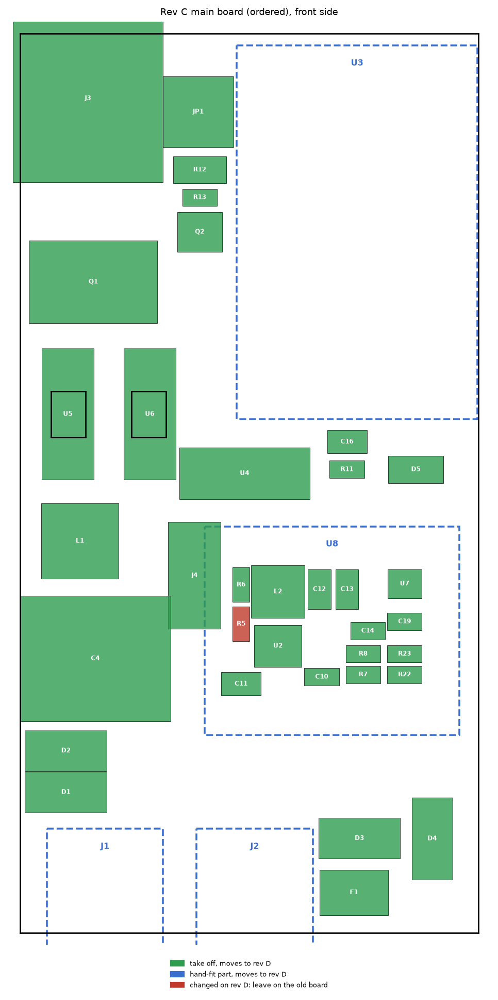
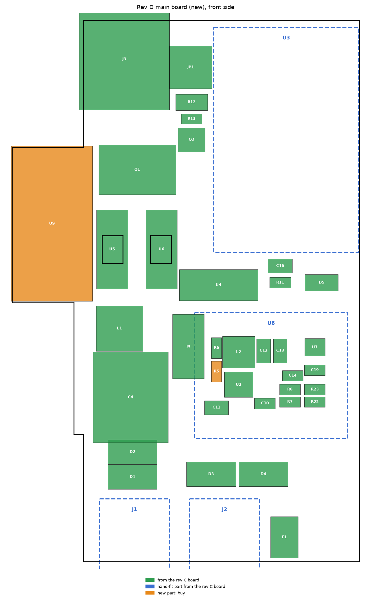
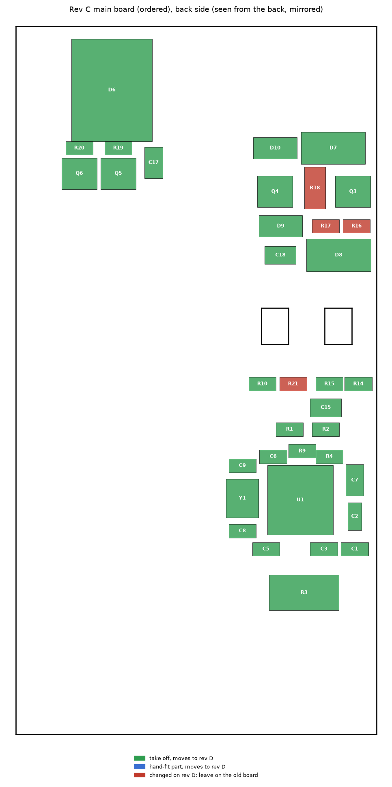
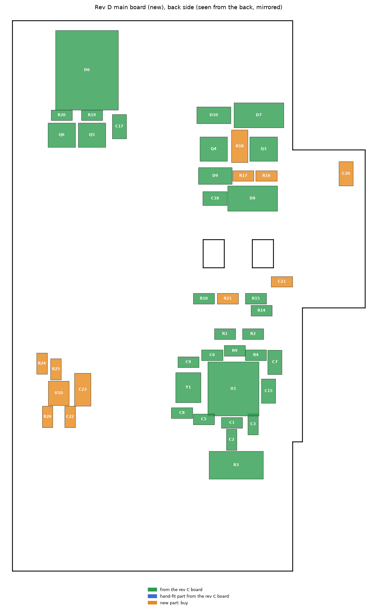

# Moving a rev C v3 gateway onto rev D boards

For a v3 PCBA ordered from commit `59eea1f` (rev C), rebuilt on the current rev D **main** board by
moving parts across. It replaces the in-place fixes in [rework-rev-c.md](rework-rev-c.md) (rev D already
has them), except sections 6 (FFC check) and 7 (bring-up measurements).

Generated data: [`rework-v3-rev-d/transfer.csv`](rework-v3-rev-d/transfer.csv), one row per rev D part
(move or buy, side on each board, removal method). Maps: `rework-v3-rev-d/*.png`. Regenerate with
`docker compose --profile hardware run --rm -T eda "python3 hardware/scripts/rework_maps.py"`.

## 1. What changes

| Board | Rev C → rev D | What to do |
|---|---|---|
| **UI** | identical: same 25 parts, positions and outline | **Keep the rev C UI board as it is.** Nothing to order or move. |
| **Main** | new PCB: tongue for the 2 W AUX converter U9, re-placed parts | Order a new main PCB. **70 of 84 parts move** (same reference, value and footprint); **14 are new or changed**. |
| **Enclosure** | rev D case (U9 channel, tongue, button tabs) | **Print the rev D enclosure** from `hardware/releases/v3/enclosure/`. The rev C print cannot take the tongue or U9. |

## 2. Order

### 2a. New main PCB

Upload `hardware/releases/v3/main/main_gerbers.zip`: **4 layers, 1.2 mm**, ENIG preferred for the QFN
pads. Order a **stencil** too (framework-less, both sides: top and bottom). Any board house works
(Aisler: `main_odb.zip`).

Easier alternative: order the main board **with JLCPCB assembly** (`main_bom_jlc.csv` +
`main_cpl_jlc.csv`) and move only the hand-fit parts (XIAO, REC3, PST strips) plus buy U9. That avoids
all SMD work; the cost is a second set of SMD parts.

### 2b. Parts to buy (moving everything else)

| Ref | Value | Package | Qty (+ spare) | LCSC | Note |
|---|---|---|---|---|---|
| **U9** | TRACO **TMR 2411** (24 V → 5 V, 2 W, isolated) | SIP-8 | 1 | — | Mouser `495-TMR-2411`, Digi-Key `1951-2741-ND` |
| **U10** | TI **TPS2121RUXR** power mux | VQFN-HR-12 2 × 2.5 mm | 1 (+1) | C485916 | fine pitch; buy a spare |
| C20 | 10 µF 50 V X5R | 0805 | 1 (+1) | C440198 | |
| C21 | 10 µF 10 V | 0603 | 1 (+1) | C19702 | |
| C22 | 100 nF 50 V X7R | 0603 | 1 (+2) | C14663 | |
| C23 | 100 µF 6.3 V X5R | 1206 | 1 (+1) | C15008 | |
| R5, R26 | 100 kΩ 1 % | 0603 | 2 (+2) | C25803 | R5 was 120k on rev C |
| R16, R21 | 4.7 kΩ 1 % | 0603 | 2 (+2) | C23162 | were 22k / 10k |
| R17, R25 | 10 kΩ 1 % | 0603 | 2 (+2) | C25804 | R17 was 100k |
| R18 | 2.0 Ω 1 % 250 mW | 1206 | 1 (+1) | C17942 | was 3.3 Ω |
| R24 | 30 kΩ 1 % | 0603 | 1 (+1) | C22984 | |

Leave the rev C R5, R16, R17, R18 and R21 on the old board (red on the maps): the values changed.

**Optional, recommended: buy the passives new instead of moving them.** 35 of the 70 movable parts are
0603/0805/1206 resistors and capacitors worth cents each. Reheated ceramic capacitors can crack
invisibly, and moving them costs most of the time. Buying them turns the job into "move 35 real
parts". They are the `assembler` rows with `R_`/`C_` footprints in `main_bom.csv`:

| Value | Package | Qty | LCSC |
|---|---|---|---|
| 100 nF 50 V X7R | 0603 | 5 | C14663 |
| 10 kΩ / 10 kΩ 1 % | 0603 | 6 | C25804 |
| 4.7 kΩ | 0603 | 3 | C23162 |
| 22 µF 25 V | 0805 | 3 | C45783 |
| 10 µF 50 V | 0805 | 2 | C440198 |
| 1 µF 50 V | 0805 | 2 | C28323 |
| 18 pF C0G | 0603 | 2 | C1647 |
| 330 Ω | 0603 | 2 | C23138 |
| 100 kΩ, 1 kΩ, 1 Ω, 51 kΩ 1 %, 680 Ω | 0603 | 1 each | C25803, C21190, C22936, C23196, C23228 |
| 10 µF 10 V, 220 nF, 47 nF | 0603 | 1 each | C19702, C64705, C1622 |
| 10 µF 25 V | 0805 | 1 | C15850 |
| 3.3 Ω | 1206 | 1 | C17945 |

### 2c. Tools and consumables

- Hot-air station with small (3–5 mm) and large nozzles; a preheater or hotplate (helps a lot on a
  4-layer board with ground planes).
- Fine iron tip (0.3–1 mm chisel), ideally a second iron or tweezers iron for chip parts.
- No-clean gel flux, solder paste (Sn63Pb37 or SAC305), 1.5–2 mm desoldering braid, desoldering
  pump for the through-hole parts, low-melt removal alloy (e.g. Chip Quik SMD1) for Q1, C4 and the PST
  strips.
- Kapton tape and aluminium foil to shield neighbours; IPA and a brush; ESD mat and tweezers;
  magnifier or microscope; multimeter.

## 3. Maps

Green = moves, blue dashed = hand-fit part (moves), orange = buy new, red = changed, leave on the old
board. Back-side views are mirrored, as you see the board when you turn it over.

| Rev C (take off) | Rev D (put on) |
|---|---|
|  |  |
|  |  |

Before you start, photograph both sides of the rev C board in good light, close enough to read the
pin-1 marks and diode bands. Positions differ on rev D; orientation marks are what you match.

## 4. Taking parts off the rev C board

Work through the sides in this order, so heavy and heat-sensitive parts come off before the board has
been heated many times. Put each part in a labelled compartment or on tape on a sheet with its
reference.

1. **Hand-fit and through-hole parts (front):** unplug the XIAO (U8); desolder the two 1×7 sockets, U3
   (REC3), J1/J2 (PST strips), J3 (KF142R terminal) and JP1. Pump each pin from the back with plenty of
   fresh solder first; for the PST strips and U3, flood all pins with low-melt alloy and lift the part
   out evenly. Skip any hand-fit part you never soldered.
2. **Big front SMD parts:** C4 (470 µF electrolytic, note the polarity stripe), L1 and L2 (inductors),
   Q1 (TO-252, low-melt alloy on the tab), F1, D1–D4 (SMA diodes, note the bands), the optocouplers
   U4–U6 (note the pin-1 dot), U2 (SCT2400), U7 (LM66100), Q2, D5, C11–C14, C16, C19, R6–R8, R11–R13,
   R22, R23.
3. **J4 (FFC connector):** plastic body, melts easily. Shield it with Kapton, use a small nozzle and
   lift by the metal tabs. If it deforms, buy a new one (C48532769; stock was low, so order early).
4. **Back side:** D6 bridge, D7–D10, Q3–Q6, Y1 (crystal), R3 (2512), C1–C3, C5–C9, C15, C17, C18,
   R1, R2, R4, R9, R10, R14, R15, R19, R20, and **U1 (NCN5130, QFN-40)**.

**Hot-air removal (QFN, SC-70, SOT-23):**
1. Preheat the board from below to about 120–150 °C.
2. Apply flux around the part.
3. Use 320–350 °C and medium airflow with a nozzle slightly larger than the part, moving in small
   circles.
4. When the solder fillets all go shiny at once, lift straight up with tweezers. Never pry: lifted pads
   on the old board don't matter, but bent leads on the part do.
5. For U1, also clean the thermal pad underneath.

**Two-iron / tweezers removal (0603–1206):** heat both ends at once and lift. Keep parts you dropped
or cracked out of the build.

**Cleaning salvaged parts:**
- Wick the leads or pads flat with flux and braid.
- QFN U1: wick the bottom pads and the centre pad flat and level, so it sits flat on the new paste.
- Clean with IPA and inspect under magnification for bridges and cracks.

## 5. Assembling the rev D main board

Work back side first: those parts are small and low, so the board can rest on them later while you
fit the tall front parts.

1. **Back side, paste and place:**
   - Stencil paste onto the back pads.
   - Place U1 (NCN5130, pin-1 dot to the pin-1 mark), U10 (TPS2121, new, pin-1 mark), Y1, all back
     resistors and capacitors (from `transfer.csv`: Rev D side = back), D6–D10 (bands as on the
     photos), Q3–Q6 and R3.
   - Reflow on a hotplate (back side down) or with hot air.
   - Check U1 and U10 for bridges with flux and a fine tip, and the pins for continuity to their traces.
2. **Front side SMD:**
   - Paste through the front stencil, or apply paste by hand pad by pad with the board on spacers.
   - Fit these one at a time with hot air (shield back-side parts and the board edge with foil):
     U2, U4–U6, U7, Q1, Q2, L1, L2, C4 (polarity), D1–D5, F1, J4, and the front passives (including
     the new R5).
3. **Through-hole parts, last:** J3, JP1, the XIAO sockets, U3 (REC3; clip pins 3 and 11 flush first),
   J1/J2 PST strips, and the new **U9 (TMR 2411)** on the tongue. U9 fits either way round in the
   footprint's outline, but pin 1 must go to the square pad: check the dot or notch on the part
   against the TRACO datasheet. Cut every lead on the back to **at most 1.5 mm**.
4. **Cleaning and inspection:** clean with IPA, then inspect every joint under magnification. Look in
   particular at U1, U10, U7 and the SOT-23 parts.

## 6. Checks before power

1. **Resistance, unpowered**, measured across each new part's pads:
   - 4.6–4.8 kΩ for R16, R21 (and R13, R22, R23 if replaced);
   - 9.9–10.1 kΩ for R17, R25;
   - 2.0 Ω for R18 (subtract the lead resistance);
   - 99–101 kΩ for R5, R26;
   - 29.7–30.3 kΩ for R24.
2. **No shorts:** +5V to GND, VFILT to GND, and +3V3 (on the XIAO header) to GND. None may read a short.
3. **FFC cable path:** do the paper-strip check from [rework-rev-c.md §6](rework-rev-c.md#6-v3-ffc-check-before-plugging-in);
   it is unchanged, and U9 now sits next to the fold.
4. **Bring-up:** follow [rework-rev-c.md §7](rework-rev-c.md#7-bring-up-measurements-expected-values).
   Add these for the new power path:

| Point | Condition | Expected |
|---|---|---|
| U9 output (+5V_AUX, at C23) | AUX 24 V only, no KNX | 4.9–5.1 V |
| +5V core | AUX 24 V only | 4.8–5.05 V (TPS2121 on the AUX input) |
| +5V core | KNX only, AUX off | 4.85–5.05 V (TPS2121 falls back to the KNX buck) |
| +5V core | KNX connected, AUX plugged and unplugged | XIAO keeps running (it can still reset if AUX is pulled during a WiFi transmit burst, the known E12 residual) |

## 7. What stays on the old board

R5, R16, R17, R18 and R21 (changed values), plus anything damaged during removal. The rev C main board
itself is scrap after this; keep it for spare parts.
