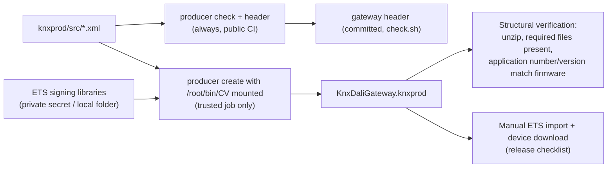

# Building the .knxprod in the pipeline

Status: proposal. Today the pipeline runs OpenKNXproducer checks and generates the firmware header in Docker; packaging the signed .knxprod is skipped because no ETS signing libraries are available.

## 1. What the .knxprod is and what blocks it

The .knxprod is the product database users import into the ETS catalog. ETS then knows the gateway's parameters, communication objects and load procedure. It is a ZIP of manufacturer XML (catalog, hardware, application program) that must be **converted and signed with ETS's own libraries**. ETS rejects unsigned or wrongly hashed product data.

OpenKNXproducer already does everything except the signing step. For signing it loads three ETS assemblies at run time: `Knx.Ets.XmlSigning.dll`, `Knx.Ets.Common.dll` and `Knx.Ets.Xml.ObjectModel.dll`, plus their dependencies.

- **Windows:** it looks for an ETS installation in `C:\Program Files (x86)\ETS6` (and ETS5 paths).
- **Linux/macOS:** it looks in `~/bin/CV/<version>/`. Its signing code explicitly handles non-Windows layouts.
- ETS 5 compatibility of KNXPROD file must stay.

So the only missing input is that folder of ETS libraries.

## 2. Options

| Option | How | Pros | Cons |
| --- | --- | --- | --- |
| A. Linux container + ETS libraries mounted (recommended) | Copy the signing assemblies once from an ETS 5 and 6 installation (the free ETS5 and 6 Demo installs them too) into a private folder. Mount it into the existing `producer` container at `/root/bin/CV/6.x`. `OpenKNXproducer create` then writes the signed .knxprod. | Same Docker image and command as today; works on Linux CI runners and on the Mac | The libraries are KNX Association property: never commit or publish them. In CI they come from an encrypted secret or private cache. Whether the ETS libraries run under .NET on Linux must be verified once. |
| B. Windows runner with ETS installed | Self-hosted Windows machine (or VM) with ETS 6; OpenKNXproducer for Windows finds ETS automatically | Matches the documented primary path exactly | Needs a Windows machine; GitHub-hosted runners have no ETS, and installing it there needs the installer and a KNX account |
| C. Wine container | Run the Windows OpenKNXproducer + ETS libraries under Wine | No Windows machine | .NET under Wine is fragile; only worth trying if A fails |

## 3. Proposed pipeline (option A)

- **Pull requests:** check + header generation only (no secrets).
- **Trusted builds** (main branch, tags): the signing job restores the libraries from an encrypted secret into a temporary folder, mounts it read-only, builds the .knxprod and deletes the folder.
- **Local:** `knxprod/scripts/package.sh <path-to-CV-folder>` runs the same container with the folder mounted.
- **Verification in CI:**
  - The archive contains catalog, hardware and application program.
  - Application number and version match the generated header and the firmware.
  - Optionally, xknxproject or a small parser reads the application program and checks object count and parameter size against the header.
- **Release:** publish the .knxprod together with the firmware built from the same commit, plus checksums.

## 4. Open points

- Which exact assembly set is needed: list the files copied from ETS and pin the ETS version they came from.
- Confirm that the signing assemblies load under .NET on Linux; if not, fall back to option B.
- Product identity before distribution: manufacturer M-00FA with an application number registered with OpenKNX, or an own KNX manufacturer ID.
